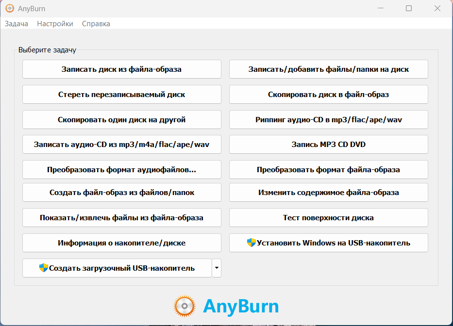
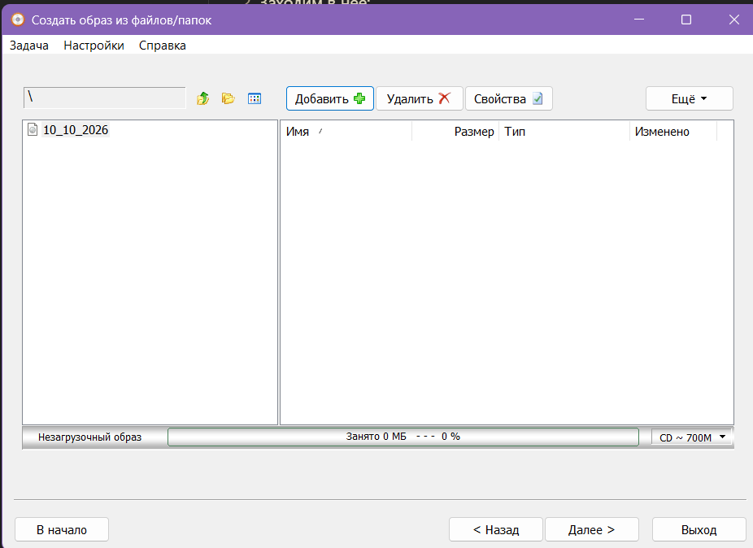
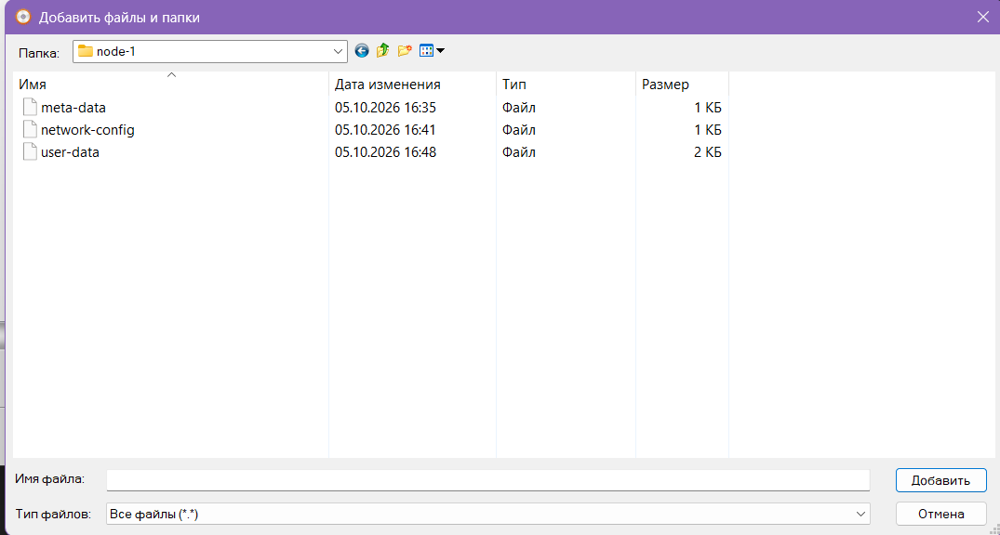
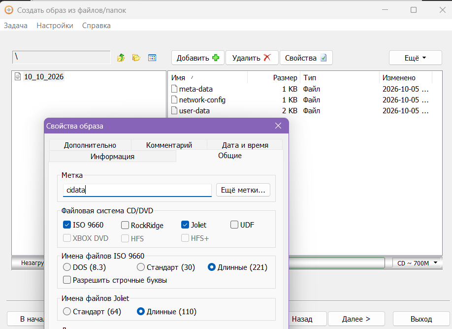
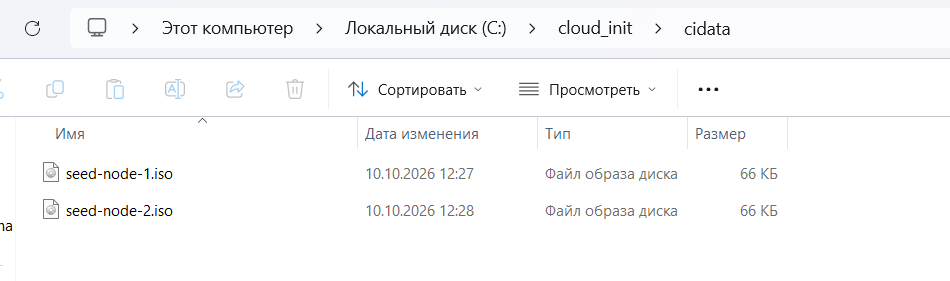

Что нужно сделать:
1. Сделать файлы конфигурации для каждой node (meta-data, user-data, network-config)
2. Если работаем на Windows(10/11):
	1. Скачиваем программу для создания ISO файлов (AnyBurn);
	2. Заходим в нее;
	3. Выбираем "Создать файл-образ из файлов/папок"
	4. Нажимаем добавить
	5. Выбираем те файлы, которые должны включаться в ISO
	6. Нажимаем свойства и меняем метку на cidata
	7. Полученный .iso файл закидываем в cidata
3. Полученный iso будем подключать в VM(Смотреть ветку связанную с VM на Git) 

