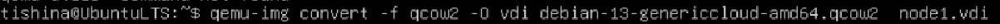
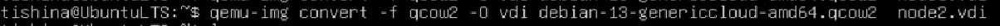
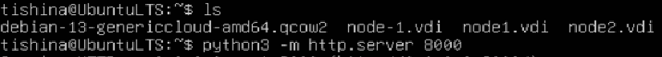
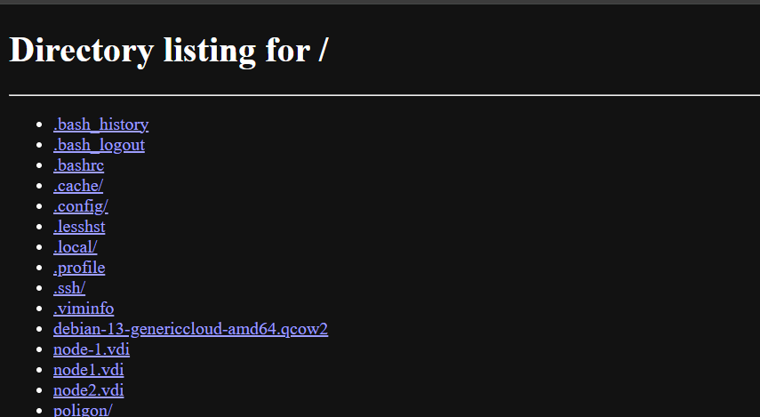
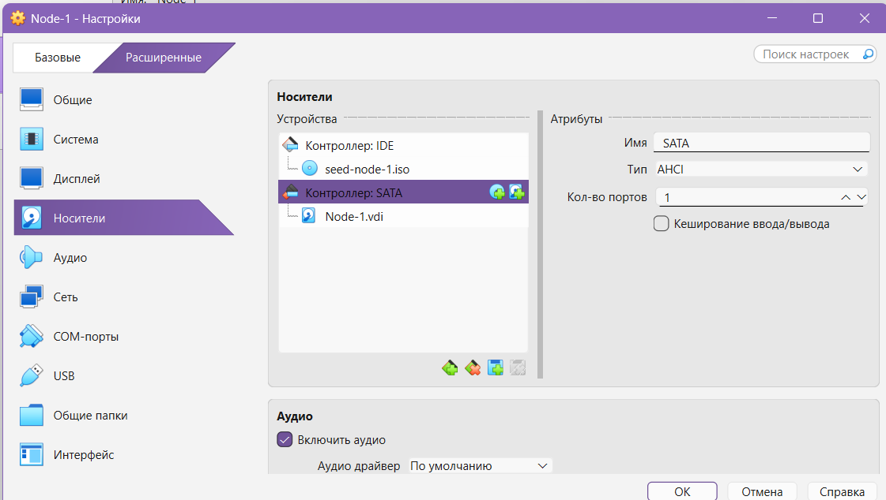

Иногда(почти всегда) файлы .qcow не воспринимаются VirtualBox-ом, но именно такой формат скачивается с оф сайта, поэтому будем конвертировать .qcow в .vdi.

Я установил себе Ubuntu13 и буду работать на ней, чтобы было проще. 
Этапы:
1. Установить конвертор:
	1. sudo apt install qemu-utils
2. Скаченный .qcow файл конвертируем через qemu-img:
	1. 
	2. Проделываем дважды, так как у нас node2 еще есть. 
3. Так как у меня VirtualBox стоит на Windows, а файлы у меня сейчас на Vbox в Ubuntu нужно их перекачать, благо python3 позволяет открыть сервер
4. Вводим в url строке любого поисковика localhost:8000 и скачиваем наши файлы
Но если вы хотите через Windows это сделать то нужно выполнить ряд действий.
Этапы:
* Открываем PowerShell или cmd, и переходим через cd в каталог с VirtualBox: у меня это просто путь "C:\Program Files\Oracle\VirtualBox".
* говорим чтобы .\VBoxManage.exe выполнил  clonemedium(клонирование) этого файла debian-13-genericcloud-amd64.qcow2 в Node-1.vdi и указываем что конвертируем в .vdi через --format VDI. 
*Пример команды: .\VBoxManage.exe clonemedium "D:\VMs\debian-13-genericcloud-amd64.qcow2" "D:\VMs\Node-1.vdi" --format VDI.
* По ТЗ нужен диск для первой node размером в 40ГБ, поэтому нужно расширить диск до этого, объема: .\VBoxManage.exe modifymedium disk "D:\VMs\Node-1.vdi" --resize 40960
	*Эта команда позволяет диску занимать 40 ГБ но не статически резервирует, а динамически расширяет.
* Проделываем эти же операции для Node-2.vdi, только расширяем до 20 ГБ, как требуется в ТЗ.
* Дальше есть два путя:
	* Можно подключить эти SATA через GUI
	* А можно через тот же PowerShell:
	*.\VBoxManage.exe storageattach "Node-1" --storagectl "SATA" --port 0 --device 0 --type hdd --medium "D:\VMs\Node-1.vdi"
	 Данная команда находит созданную VM с именем Node-1 трогает --storagectl "SATA" с портом 0 и устройством 0 и указывается тип диска hdd а потом указываем наш .vdi

Важно!
	Теперь к самому важному:
		Давайте представим вы сделали .vdi потом подключили к VM его но вдруг вам ну просто необходимо изменить конфиг юзера или что-то подобное, но ваш cloud-init запускается единожды, при первом запуске виртуальной машины, дальше его считай нет))
		Итак: ваши действия по пересозданию .vdi:
		1. Перейди в каталог с VirtualBox: cd "C:\Program Files\Oracle\VirtualBox"\
		2. Дальше даже если вы физически удалите Node-1 то UID вашего .vdi останется в системе, так что нужно открепить его: .\VBoxManage.exe storageattach "Node-1" --storagectl "SATA" --port 0 --device 0 --medium none
		3. Открепи и Node-2
		4. Удаляем старые записи: .\VBoxManage.exe closemedium disk "D:\VMs\Node-1.vdi" --delete
		5. Также и для Node-2
		6. Теперь можно повторить алгоритм по созданию заново. Удачи!
